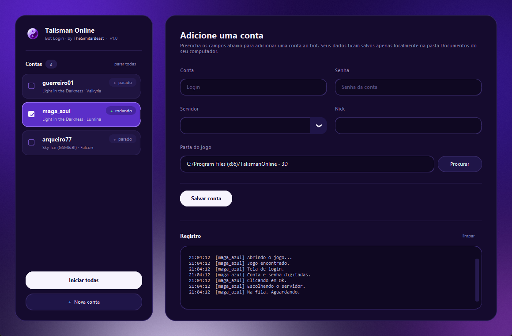

# Bot Login — Talisman Online

Automatiza a parte chata de entrar no Talisman Online: digita conta e senha, escolhe servidor e personagem, espera a fila e reconecta sozinho quando a conexão cai. Dá pra deixar várias contas logando ao mesmo tempo.

Ele **não joga por você** — não anda, não farma, não luta. É só o login.



## Como funciona

O bot olha a janela do jogo, reconhece em que tela você está comparando com imagens de referência, e clica no lugar certo. Em vez de mover o mouse de verdade, ele manda o clique direto pra janela do jogo pelo próprio Windows — então **você continua usando o PC normalmente** enquanto ele trabalha. A única exigência é não minimizar a janela do jogo (pode ficar atrás de outras).

Na tela de fila ele nunca clica em nada, nem no "Cancel" — só espera e avisa no log.

## Instalando

### Opção 1 — rodando o código (recomendada)

Precisa de [Python 3.9+](https://www.python.org/downloads/) no Windows, com a opção **"Add python.exe to PATH"** marcada na instalação.

```
git clone https://github.com/ricardoparaizo/talisman-login-bot.git
cd talisman-login-bot
pip install -r requirements.txt
python bot.py
```

### Opção 2 — gerando um .exe

Rode o `build_exe.bat`. Ele instala o que falta e gera `dist\TalismanLoginBot.exe`, um arquivo único que roda em qualquer PC Windows sem precisar de Python instalado.

Se preferir baixar o `.exe` pronto, ele está nas [Releases](https://github.com/ricardoparaizo/talisman-login-bot/releases) — mas leia a seção sobre antivírus antes.

## Usando

1. Abra o bot e clique em **+ Nova conta**.
2. Preencha login, senha, servidor e nick.
3. Em **Pasta do jogo**, aponte onde o Talisman está instalado (a pasta que tem o `game.exe`). Com isso preenchido, o bot abre o jogo sozinho; deixando em branco, você abre o jogo antes de iniciar.
4. Clique em **Salvar conta**.
5. Marque a caixinha da conta pra iniciar o login. Desmarcar para.

**Iniciar todas** sobe todas as contas de uma vez — cada uma numa cópia própria do jogo. Clique com o **botão direito** numa conta pra editar ou remover (é o único jeito de editar uma conta já cadastrada).

## Onde ficam seus dados

Tudo fica em `Documentos\Bot Login - Talisman Online\`, **fora da pasta do bot**. Isso é de propósito: você pode mandar o bot (ou o `.exe`) pra qualquer pessoa sem mandar suas contas junto.

Nada é enviado pra internet — o bot não faz nenhuma conexão de rede.

> ⚠️ **As senhas ficam em texto legível** no `perfis.json`, para você poder abrir e conferir exatamente o que está salvo. Em compensação, quem tiver acesso a esse arquivo lê as senhas. Não compartilhe o `perfis.json`, e tome cuidado se a sua pasta Documentos tem backup automático em nuvem.

## Sobre o antivírus

Alguns antivírus marcam o `.exe` como suspeito. **É falso positivo**, e vale entender o motivo antes de decidir se você confia:

A causa é o PyInstaller, a ferramenta que transforma código Python em `.exe`. O "miolo" que ele injeta é idêntico em todo programa feito com ele — inclusive nos maliciosos — então os antivírus que usam machine learning marcam por semelhança. Some a isso um arquivo sem assinatura digital e sem reputação. Repare que as detecções costumam ter nome genérico (`Wacatac`, `Trojan.Blank`) e sufixo `!ml`, que é a própria Microsoft dizendo "isso foi um modelo estatístico, não uma assinatura de vírus conhecido".

Se você prefere não confiar num `.exe` de estranho — o que é uma postura sensata para um programa que digita sua senha — **use a Opção 1**. O código é Python puro e legível, dá pra ler tudo antes de rodar.

## Se alguma tela não for reconhecida

O bot identifica as telas comparando com os recortes em `templates/`. Eles foram capturados em ~1024x768 e são redimensionados automaticamente para outras resoluções (800x600 até 1920x1080).

Se o jogo atualizar a interface, ou se o seu servidor tiver um visual diferente, algum template pode parar de bater — o log vai avisar que não reconheceu a tela. Nesse caso, tire um print da janela do jogo, recorte o pedaço equivalente e substitua o arquivo em `templates/`. O `config.json` lista o que cada um representa.

O template de personagem é específico do nick que estava na tela quando foi capturado. Se o seu personagem tem outro nome, o bot ignora essa etapa e clica direto em "Enter Game", assumindo que o servidor já deixou o personagem certo selecionado.

## Aviso

Automatizar login pode não ser oficialmente suportado pela publisher do jogo, e o risco (banimento, etc.) é seu. Os atrasos aleatórios entre as ações ajudam a não martelar o servidor, mas não são garantia de nada. Use com bom senso.

## Arquivos do projeto

| Arquivo | O que faz |
|---|---|
| `bot.py` | Motor: reconhece as telas e decide o que clicar |
| `gui.py` | Interface gráfica (CustomTkinter) |
| `profiles.py` | Contas e senhas, salvos em Documentos |
| `win_input.py` | Clique e digitação em segundo plano, via Windows |
| `screen_match.py` | Comparação de imagem e ajuste de escala |
| `paths.py` | Onde cada coisa mora (programa × usuário) |
| `config.json` | Ajustes finos e lista de templates |
| `templates/` | Recortes das telas do jogo usados no reconhecimento |
| `build_exe.bat` | Gera o `.exe` na sua máquina |

## Licença

MIT — veja [LICENSE](LICENSE).
